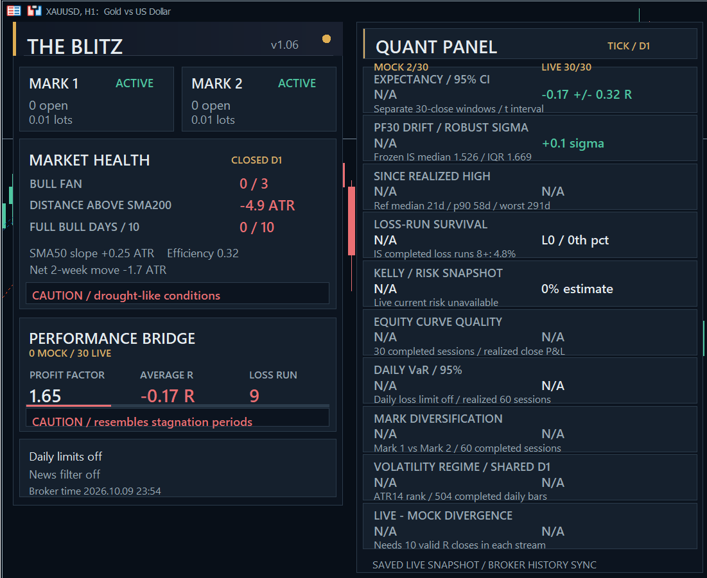
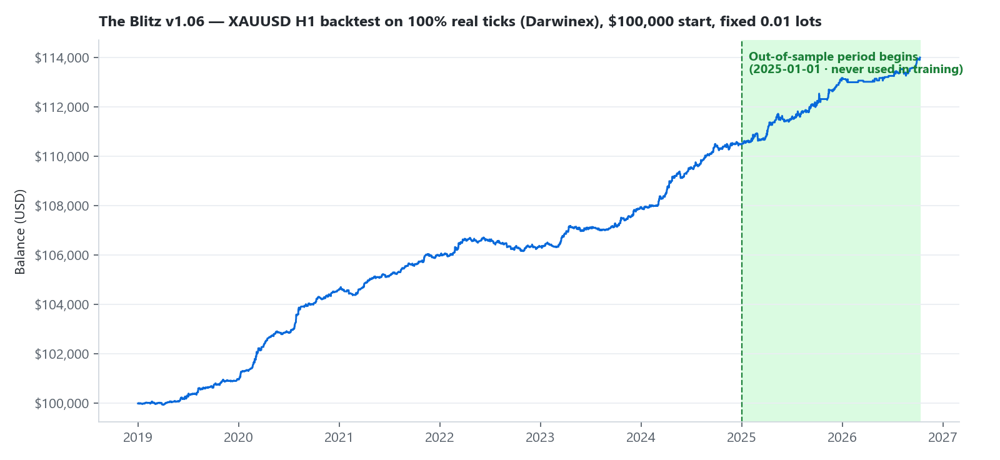
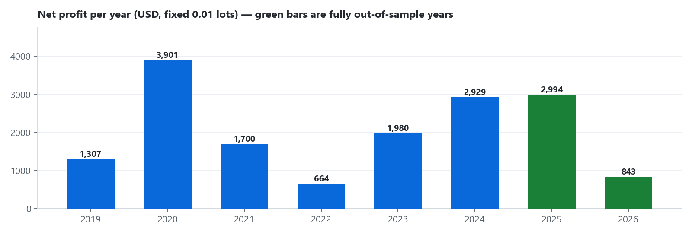

  

# The Blitz — Machine-Learning Gold Trading for MetaTrader 5

**Version 1.06** · Symbol: **Gold (XAUUSD)** · Default chart timeframe: **H1** · Hedging account

The Blitz is a fully automated Expert Advisor for Gold, built on a machine-learning model and engineered around one principle: **trade selectively, protect every position, and prove it out-of-sample.**

---

## What The Blitz is — in one page

**A disciplined, model-driven Gold trader.** The Blitz evaluates the market on every completed bar using a machine-learning model trained on years of Gold price behavior. It trades in both directions (long and short), holds positions for hours rather than weeks, and only enters when the model sees a statistically meaningful edge. Two complementary internal engines work side by side — one tuned to the hourly rhythm of the market, one to the slower 4-hour rhythm — smoothing each other's results.

**Machine learning, done honestly.** The uncomfortable truth about ML-based trading systems is overfitting: a model can memorize the past instead of learning from it. The Blitz was built to survive that test. The model was developed on historical data **through the end of 2024 only** — and the entire period of **2025 and 2026 was reserved as untouched out-of-sample data**. No tuning, no adjustments, no peeking. That out-of-sample window covers some of the most erratic Gold price behavior in years — the violent rallies, sharp reversals, and volatility spikes of 2025–2026 — and the strategy kept performing on data it had never seen:

| Out-of-sample results (2025-01-01 → 2026-10-10, backtest) | |
|---|---|
| Trades | 539 |
| Profit factor | **1.69** |
| Win rate | **61.8 %** |
| Max balance drawdown | ≈ 0.3 % of the running balance |

**Risk control on every single trade.** **No martingale. No grid. No averaging down.** Every position has a real stop loss and take profit from the moment it opens, a volatility-adaptive trailing stop, and a maximum holding time — dead trades are recycled, not hoped back to life. Optional account-level protections let you enforce daily loss limits, block trading around major news, and force flat positions before the weekend.

**Advanced order management for live trading.** Entries are only half the job — The Blitz actively manages every live order until it closes. Stops and targets sit on the broker's server from the first second, so your protection survives a disconnected PC. The trailing stop ratchets in your favor and never backwards. Time stops close stale positions at market. Execution is engineered for real conditions: spread and slippage gates before entry, broker stop-level and volume-step compliance handled automatically, partial fills accepted, and failed modifications logged instead of silently ignored. After a terminal restart, the EA re-reads its open positions and account history and resumes managing them exactly where it left off.

**A dashboard that tells you when to worry — and when not to.** The Blitz ships with a state-of-the-art information panel that goes far beyond "profit so far". It continuously measures the current market regime, compares your live results against the strategy's historical reference profile (profit-factor drift, stagnation length, losing-streak statistics, volatility regime, and more), and flags when performance starts to resemble historically difficult periods. It is, in effect, a built-in early-warning system: you always know whether what you're seeing is normal variance or something worth acting on.

  

*The Blitz dashboard (left) and Quant Panel (right) on a live chart — here shown in a live CAUTION state: the panels had flagged that recent results resembled historical stagnation periods. This is the early-warning system doing its job.*

**Ready out of the box.** Default settings are the intended configuration — Gold, H1 chart, conservative 0.01 lots per engine. No optimization, no parameter hunting. Attach, enable, done.

---

## Backtest at a glance

Strategy Tester, **XAUUSD H1, 2019-01-01 → 2026-10-10, 100 % real ticks** (Darwinex), $100,000 start, fixed 0.01 lots, default settings:

| Metric | Value |
|---|---|
| Net profit | +$14,010 |
| Profit factor | 1.68 |
| Win rate | 60.9 % (4,096 trades) |
| Max equity drawdown | **0.54 %** ($577) |
| Sharpe ratio | 3.70 |
| Recovery factor | 24.3 |
| Average holding time | ≈ 18 hours |

*2026 is a partial year (through October 10). All figures come from a backtest with the smallest available position size — read them as a measure of strategy quality, not as a promise of future returns. Past performance does not guarantee future results.*

---

## What retail traders ask — and how The Blitz answers

| You ask | The Blitz |
|---|---|
| "Is it a disguised grid or martingale?" | **No.** Independent trades only, each with its own hard stop loss. Verified in the trade history: one position per signal, max 2 per engine. |
| "Is the ML model just overfitted?" | The model never saw 2025–2026 during development. The out-of-sample period — including the erratic 2025–2026 market — shows profit factor 1.69, essentially identical to the full-period 1.68. |
| "What's the drawdown?" | 0.54 % maximum equity drawdown in a nearly 8-year real-tick test with fixed minimum lots. |
| "How do I know it's still working?" | The built-in Quant Panel continuously compares your live results to the strategy's historical profile and warns you when performance drifts outside it — before it shows up in your balance. |
| "Is it complicated to set up?" | No. Defaults are the intended setup. Every optional feature (risk %, daily limits, news filter, schedules) is off until you switch it on. |
| "Can I use it for a prop-firm challenge?" | Yes — built-in daily loss and drawdown limits, lot caps, and Friday close help you stay inside firm rules. |
| "What do I need to run it?" | Any MT5 **hedging** account, a Gold chart on H1, Algo Trading enabled. A VPS is recommended but not required. |

---

## Documentation

| Document | Contents |
|---|---|
| [Getting started & requirements](#getting-started) | Install in 5 minutes |
| [docs/how-it-works.md](docs/how-it-works.md) | General strategy principles and every protective system |
| [docs/settings.md](docs/settings.md) | Every setting explained in plain language |
| [docs/dashboard.md](docs/dashboard.md) | Every statistic on the dashboard and Quant Panel |
| [docs/faq.md](docs/faq.md) | Full FAQ and troubleshooting |

## Getting started

Requirements: MetaTrader 5, a **hedging** account, and your broker's Gold symbol.

1. Copy `The_Blitz_v1_06.ex5` into `MQL5/Experts/` (*File → Open Data Folder → MQL5 → Experts*).
2. Open a **Gold (XAUUSD)** chart, set the timeframe to **H1**.
3. Drag The Blitz onto the chart, keep the default settings, click OK.
4. Make sure **Algo Trading** is enabled (toolbar button green).

Both engines start trading automatically. The dashboard and Quant Panel appear on the chart. A VPS is recommended for uninterrupted operation but not required.

---

> **Risk warning.** Trading leveraged Gold carries a high risk of loss. Backtest results — including the out-of-sample period shown here — describe the past, not the future. Trade only money you can afford to lose, and run a demo account first.
